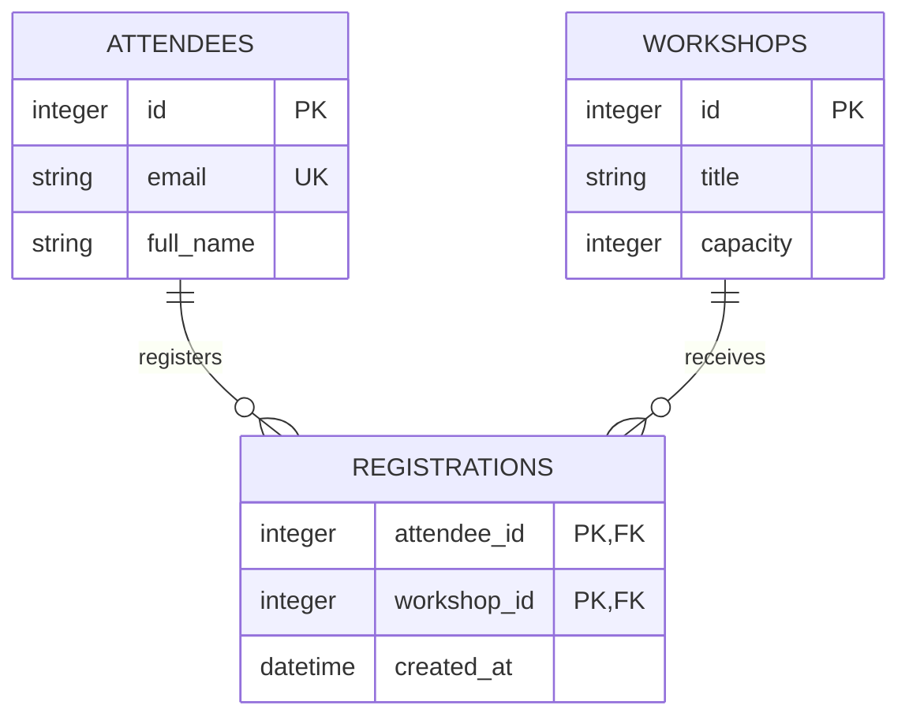

# Database và ERD từ nghiệp vụ đến triển khai

## Kết quả cần có

FULL cần phần thiết kế dữ liệu riêng, ERD nguồn có thể chỉnh sửa và database thật cho phần nghiệp vụ cần lưu trữ. Chọn database theo stack/đề; không ép dùng một hệ quản trị cố định. Nếu dùng document store, phân biệt mô hình quan hệ nghiệp vụ và cấu trúc collection triển khai; giải thích tham chiếu hoặc nhúng thay vì giả vờ hệ thống có ràng buộc FK.

Trong mục Database/ERD của `docs/PROJECT_A_TO_Z.md`, ghi các nội dung dưới đây. Có thể dùng `docs/database.md` làm phụ lục khi schema lớn, nhưng A–Z vẫn phải nhúng ERD và giải thích đầy đủ các quan hệ/rule cần bảo vệ:

- Hệ lưu trữ được chọn và lý do gắn với bài toán, thời gian, môi trường demo.
- Thực thể/bảng và trách nhiệm, quan hệ, nguồn rule, các giả định.
- Data dictionary: tên cột, kiểu, nullable, mặc định, PK/FK/unique/check và ý nghĩa nghiệp vụ; index thật sự cần và lý do.
- Rule tạo/sửa/xóa, hành vi khi xóa bản ghi được tham chiếu, transaction ở các thao tác cần tính nguyên tử.
- Đường dẫn schema/ORM, migration, seed, ERD; lệnh tạo DB mới và lệnh kiểm tra.

Không lưu các trường dư thừa hoặc tạo bảng người dùng/quyền chỉ vì “app nào cũng có”. Mỗi bảng/cột phải phục vụ yêu cầu hoặc lựa chọn thiết kế đã giải thích. Nếu lưu mật khẩu theo yêu cầu, chỉ lưu hash phù hợp, không plaintext; không đưa credential thật vào dữ liệu demo.

## Thiết kế khóa và quan hệ

1. Rút thực thể từ nghiệp vụ, không coi mọi màn hình là một bảng.
2. Chọn khóa chính ổn định; xác định khóa nghiệp vụ cần unique. Làm rõ đơn vị, kiểu thời gian và miền giá trị khi ảnh hưởng rule.
3. Với 1–N, đặt FK ở phía N; FK nullable hay bắt buộc phải khớp quan hệ tùy chọn hay bắt buộc trong sơ đồ.
4. Với 1–1 vật lý, FK cần unique hoặc cơ chế tương đương; chỉ nối hai bảng trên hình không tạo được ràng buộc 1–1.
5. Với N–N quan hệ, tạo bảng nối; ngăn trùng cặp bằng PK ghép hoặc unique phù hợp nếu nghiệp vụ không cho lặp. Có thuộc tính của quan hệ thì đặt ở bảng nối.
6. Chọn hành vi xóa/sửa tham chiếu theo rule, không mặc định cascade toàn bộ. Ràng buộc khả thi nên được bảo vệ trong DB và ứng dụng; tránh chỉ kiểm tra ở giao diện.
7. Với thao tác như giữ chỗ/trừ tồn kho, xem xét cập nhật nguyên tử/transaction và ràng buộc để không vượt số lượng khi thao tác đồng thời; chọn mức xử lý phù hợp yêu cầu thực tế.

Không bắt buộc chuẩn hóa phức tạp, audit log hoặc soft delete nếu đề không cần. Giải thích đánh đổi khi giữ dữ liệu trùng hoặc dùng JSON cho cấu trúc linh hoạt.

## Sơ đồ ERD

Lưu `docs/diagrams/erd.mmd` với nội dung Mermaid `erDiagram` thuần, không có hàng rào Markdown trong file `.mmd`. Trong A–Z, nhúng nội dung bằng khối `mermaid` để đọc độc lập; ảnh render là bản bổ sung. Trong SLIDE_GEN, cung cấp ERD hoặc phần sơ đồ đúng phạm vi slide cùng lời giải thích, không chỉ dẫn đường dẫn local mà công cụ sinh slide bên ngoài không mở được. Dùng tên bảng/cột kỹ thuật trùng tên triển khai; giải thích bằng tiếng Việt ở data dictionary.

Thể hiện PK, FK, unique và lực lượng quan hệ, đồng thời ghi nullability/rule chi tiết trong dictionary vì hình không thể hiện hết ràng buộc. Không tự nối các bảng không có quan hệ. Quan hệ tùy chọn bắt đầu từ 0, quan hệ bắt buộc bắt đầu từ 1.

Ví dụ minh họa cho nghiệp vụ đăng ký workshop, không phải schema mặc định cho mọi đề:

Trong ví dụ, mỗi đăng ký có đúng một người và một workshop; một người/workshop có thể có 0..N đăng ký. PK ghép ngăn người dùng đăng ký lặp cùng workshop. Hai FK phải NOT NULL, capacity phải được kiểm tra theo rule. Kiểu cụ thể và cú pháp SQL phụ thuộc DB; ánh xạ rõ kiểu Mermaid sang kiểu thực tế. Nếu hệ thống có hủy/đăng ký lại hoặc lưu lịch sử, điều chỉnh mô hình theo rule đó, không chép nguyên ví dụ.

Render SVG/PNG bằng công cụ Mermaid sẵn có khi có thể và mở hình để kiểm tra khả năng đọc. Với ERD lớn, có một hình tổng quan và các hình theo miền, vẫn giữ nguồn đầy đủ. Không dùng ảnh vẽ tay hoặc ảnh AI làm nguồn schema. Nếu không có công cụ render, bàn giao nguồn `.mmd` và nhúng Mermaid vào Markdown, ghi ảnh chưa xuất; không giả định đã kiểm tra hình chỉ vì source có vẻ đúng.

## Từ ERD sang database chạy được

- Dùng nguồn schema/migration chuẩn của stack hiện có. ORM migration đã là nguồn chạy được thì không tạo thêm một bản SQL song song dễ lệch; xuất SQL chỉ khi cần và giữ đồng bộ.
- Viết lệnh tạo DB mới theo thứ tự đúng và seed dữ liệu tổng hợp đủ chạy demo. Seed cần có cách chạy lại được trên DB demo mà không nhân bản dữ liệu ngoài ý muốn; không reset DB thật để tiện làm demo.
- Dữ liệu mẫu phải khớp FK, trạng thái và rule. Cấu hình connection dùng biến môi trường hoặc cơ chế phù hợp, không hardcode secret.
- Triển khai việc đọc/ghi qua service/API/CLI thật. Nếu kế hoạch đòi lưu bền vững, kiểm tra dữ liệu còn sau khi khởi động lại phù hợp môi trường.
- Khi schema thay đổi, cập nhật ERD, dictionary, đặc tả, migration và seed cùng lượt. Không sửa trực tiếp DB để demo rồi để schema trong repo cũ.

## Kiểm chứng trước bàn giao

Trên DB local/tạm được phép, chạy tạo mới và seed. Kiểm tra một luồng ghi rồi đọc từ ứng dụng, FK hoặc cơ chế tham chiếu, unique quan trọng, nullable/check và hành vi xóa nếu có ảnh hưởng nghiệp vụ. Với rule transaction/giữ chỗ có trong đề, kiểm tra nhánh thất bại hoặc thao tác cạnh tranh có ý nghĩa.

Đối chiếu schema thật hoặc introspection/ORM metadata với ERD: không thiếu bảng, không dư quan hệ giả, đúng cột khóa, phía FK, tính tùy chọn và unique tạo quan hệ 1–1. Ghi lệnh/input, kết quả và bằng chứng trong phần kiểm chứng của A–Z; có thể dẫn thêm `docs/verification.md` nếu đã có. Nếu chỉ có thiết kế mà chưa tạo được DB, gắn nhãn “thiết kế, chưa triển khai/kiểm chứng” nhất quán trong A–Z và SLIDE_GEN, nêu lý do.

Khi bảo vệ, đội cần giải thích được ít nhất một quan hệ quan trọng, một ràng buộc bảo vệ nghiệp vụ và đường đi của một bản ghi từ input → module xử lý → database → output. Đây là gợi ý luyện nói, không phải thang điểm chính thức.
